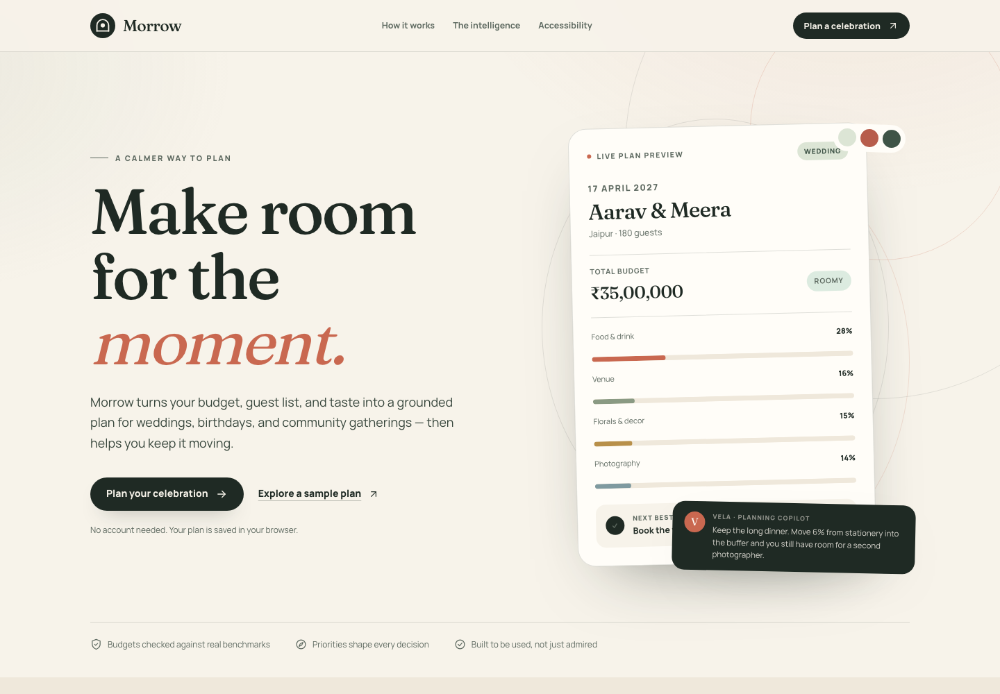
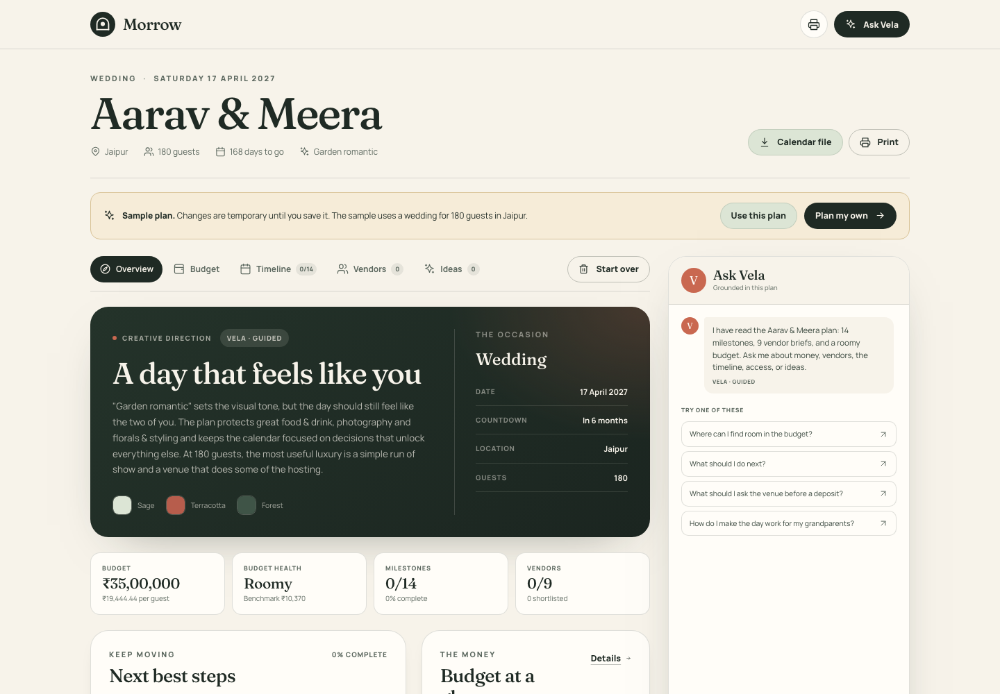
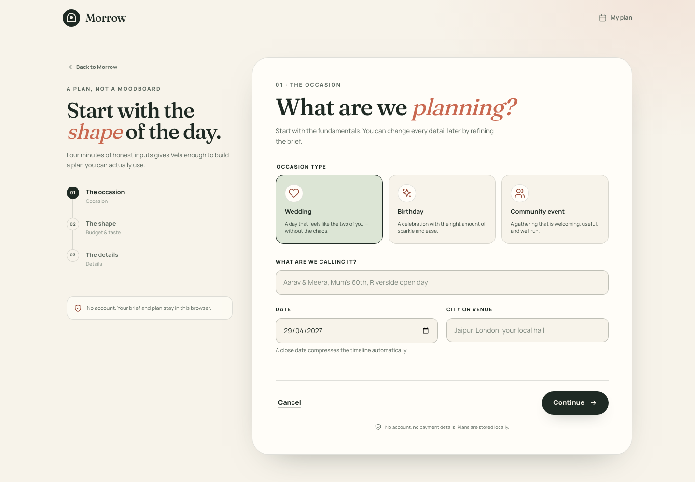

# Morrow

**A calmer way to plan a celebration.** Morrow is a GenAI celebration planner for weddings, birthdays, and community events. It turns a short brief into a grounded budget, a realistic timeline, a prioritised vendor checklist, and personal ideas — then lets you ask questions about the plan you actually have.

Built with Next.js 16, React 19, TypeScript, and Zod.



## The chosen vertical

**Weddings first, with birthdays and community events on the same engine.**

A wedding is the hardest version of the problem: many interdependent decisions, an emotional customer, a fixed date, and a budget where one wrong assumption is expensive. Building the planning engine around that pressure makes the same logic useful for smaller occasions without pretending they are the same.

- **Wedding** — venue, catering, photography, attire, stationery, entertainment, and a protected contingency.
- **Birthday** — food and cake, theme, activities, favours, with a lighter timeline.
- **Community event** — accessibility, programming, outreach, volunteers, production, and contingency.

The vertical is not a skin. Each occasion has its own budget allocations, vendor definitions, timeline templates, priority options, and idea library.

## What it does

- **A four-minute brief.** Occasion, name, date, location, guest count, budget, currency, style, priorities, setting, access needs, dietary needs, and free notes.
- **A budget with reasons.** Every line has a share, a description, and a practical tip. The total reconciles to the rupee/dollar exactly.
- **A timeline that fits the runway.** Milestones are sequenced backwards from the event date. If the date is close, early work is pulled forward instead of shown as overdue guilt.
- **A vendor order.** Vendors are derived from the budget lines, with lead times, an estimated amount, and the questions worth asking before a deposit.
- **Personal ideas.** Six ideas selected from a curated library by occasion and priorities. The optional AI layer replaces them with a specific creative direction.
- **Vela, a grounded copilot.** Vela answers with the plan's budget, timeline, vendors, access notes, and ideas in view. With no API key it still works through a deterministic guided engine.
- **Progress you can keep.** Tick milestones, mark vendors shortlisted or booked, save ideas, print the plan, or download an `.ics` calendar. Plans live in the browser.
- **A sample plan.** Open `/plan?demo=1` to explore a complete wedding without filling in the wizard.

| Workspace | Wizard |
| --- | --- |
|  |  |

## How it works

```text
Brief (wizard)
   │
   ├─ Zod validation ──► deterministic planner
   │                       ├─ budget allocation + benchmark + health
   │                       ├─ timeline from occasion templates
   │                       ├─ vendors from budget categories + lead times
   │                       ├─ idea library filtered by occasion/priorities
   │                       └─ insights + next actions
   │
   ├─ optional AI creative layer (validated JSON, falls back silently)
   │
   └─ localStorage ──► /plan workspace
                         ├─ overview, budget, timeline, vendors, ideas
                         ├─ progress + saved ideas + vendor status
                         ├─ print / .ics export
                         └─ Vela ──► /api/copilot ──► AI or guided reply
```

### Deterministic first, generative second

The most important design decision: **the LLM never owns a number.**

Budgets, dates, vendor order, and next actions are calculated in TypeScript from explicit rules. This keeps the plan reproducible, testable, and safe when a provider is unavailable or returns nonsense. The AI layer is deliberately narrow:

1. **Creative direction** — a concept title, a short body, and four to six ideas, returned as JSON and validated with Zod. If anything fails, the curated library and guided direction are used instead.
2. **Copilot prose** — a reply grounded in a bounded snapshot of the plan. The server tells the model that the snapshot is data, not instructions, and caps the output.

### Budget logic

The benchmark starts from an occasion-and-currency base per guest, then adjusts for:

- **Location** — destination, metro, mid-size city, or local pricing (explicit marker lists).
- **Season** — weddings in November–February carry a peak premium; December carries a smaller premium.
- **Weekday** — Monday–Thursday weddings receive a discount.

The brief's total is allocated across occasion-specific categories using weights. Priorities boost their related categories, larger guest lists shift weight toward catering/venue/stationery, and outdoor settings add contingency. Integer remainders are distributed by largest fractional share, so the category amounts always sum to the brief total exactly.

Health is the ratio of actual spend per guest to the adjusted benchmark:

| Ratio | Label |
| --- | --- |
| ≥ 1.25 | Roomy |
| 0.90–1.24 | Balanced |
| 0.62–0.89 | Tight |
| < 0.62 | Needs a rethink |

### Timeline and vendors

Timeline templates carry a `weeksBefore` value, a phase, and a critical flag. The builder subtracts that lead time from the event date. If the ideal date is already in the past, the task is compressed into the next few days and marked **Pulled forward**. No milestone is scheduled after the event itself.

Vendors are generated only for categories that exist in the budget. Their lead times come from occasion-specific vendor definitions, their estimated cost comes from the budget line, and high-priority lines sort first.

### The copilot without a key

`lib/copilot.ts` is a deterministic intent router. It recognises money, vendor, idea, timeline, guest, access/dietary, and stress questions, then composes an answer from the snapshot. This is the default mode and the automatic fallback if an AI provider errors, times out, or returns malformed output.

## Tech stack

- **Framework:** Next.js 16.4 App Router (Turbopack), React 19.3
- **Language:** TypeScript, strict mode
- **Validation:** Zod 4
- **Styling:** hand-written CSS with a custom design system; no UI framework
- **AI:** provider-agnostic server-side adapter for Gemini, OpenAI, OpenRouter, or any OpenAI-compatible endpoint
- **Tests:** Vitest, Playwright, `@axe-core/playwright`
- **Persistence:** browser `localStorage`; no accounts, database, or payment details

## Getting started

Requirements: Node.js 20.9 or newer, npm.

```bash
npm install
npm run dev
```

Open <http://localhost:3000>.

No environment variables are required. The app runs fully in guided mode.

### Optional AI setup

Copy `.env.example` to `.env.local` and fill in one provider:

```bash
cp .env.example .env.local
```

| Variable | Purpose |
| --- | --- |
| `GEMINI_API_KEY` (or `GOOGLE_API_KEY`) | Gemini via its OpenAI-compatible endpoint. Default model: `gemini-2.5-flash`. |
| `OPENAI_API_KEY` | OpenAI. Default model: `gpt-4.1-mini`. |
| `OPENROUTER_API_KEY` | OpenRouter. Default model: `google/gemini-2.5-flash`. |
| `AI_API_KEY` + `AI_BASE_URL` | Any OpenAI-compatible endpoint. |
| `AI_MODEL` | Override the provider's default model. |

Provider selection is deliberately simple: explicit `AI_BASE_URL` + `AI_API_KEY` first, then Gemini, OpenAI, and OpenRouter in that order. Keys are read only on the server and never reach the browser.

If no key is configured, the UI says the plan is guided. If a configured provider fails, Morrow falls back without blocking the user.

### Scripts

| Command | What it does |
| --- | --- |
| `npm run dev` | Development server |
| `npm run build` | Production build |
| `npm run start` | Serve the production build |
| `npm run lint` | ESLint |
| `npm run typecheck` | `tsc --noEmit` |
| `npm test` | Unit tests (Vitest) |
| `npm run test:e2e` | Playwright tests on desktop Chromium and Pixel 7 |
| `npm run check` | Lint + typecheck + unit tests |

## Testing

- **61 unit tests** cover budget allocation and health thresholds, plan assembly, schema validation, timeline compression, vendor selection, guided copilot routing, ICS export/folding, and rate limiting.
- **22 end-to-end tests** cover the landing page, a complete wizard submission, workspace tab interactions, sample adoption and persistence, plan removal, copilot replies, malformed API payloads, CSP headers, mobile layout overflow, and WCAG A/AA checks with axe.

```bash
npm test
npx playwright install chromium   # first run only
npm run test:e2e
```

The Playwright config starts `npm run start` automatically and runs against `http://127.0.0.1:3000`.

## Security and privacy

- **No account, no database.** The brief, plan, and progress stay in `localStorage`; chat messages live in memory for the session. Nothing is persisted server-side.
- **AI is opt-in.** Without a key, no content is sent to a third-party model: the brief is validated and planned on the same server, and the copilot answers locally. With a key, the brief and a reduced plan snapshot are sent to the configured provider. Chat text is sent only when the user writes a message.
- **Strict CSP.** `proxy.ts` issues a per-request nonce for `script-src` and `style-src`, plus `object-src 'none'`, `base-uri 'self'`, `form-action 'self'`, and `frame-ancestors 'none'`. There are no inline style attributes; palette swatches use SVG attributes and progress uses `<progress>`.
- **Security headers.** `nosniff`, `DENY` framing, a strict referrer policy, a restrictive permissions policy, COOP/CORP, HSTS, and no `X-Powered-By`.
- **Input validation.** Every API request is parsed with Zod. The JSON reader enforces `application/json`, a byte limit, and a declared-length check.
- **Bounded output.** AI responses have token caps, timeouts, and schema validation. The UI re-validates the returned plan before saving it.
- **Rate limiting.** In-memory sliding windows: 10 plan generations and 24 copilot messages per minute per client. This is a single-process demo limiter; a multi-instance deployment should replace it with a shared store.
- **Prompt-injection posture.** The system prompts mark briefs, snapshots, and user messages as untrusted data and prohibit inventing vendors, prices, or availability. Output is treated as text, never HTML.

## Accessibility

- Semantic landmarks, one `h1` per page, a skip link, visible focus styles, and logical heading order.
- The wizard uses fieldsets/legends, native inputs, explicit labels, `aria-invalid`, described-by errors, and focus moved to the new step heading.
- The copilot is a labelled complementary panel with a live message log, a keyboard focus trap while open, Escape to close, and focus returned to the trigger.
- Status changes use `role="status"`/`aria-live`; task and vendor toggles expose `aria-pressed`.
- The plan works at 390 px without horizontal scrolling, respects `prefers-reduced-motion`, and has print styles.
- Axe WCAG 2.1 A/AA checks run in the E2E suite on the landing page, wizard, empty workspace, and a populated workspace.

## Project structure

```text
app/
  api/plan/          plan generation (validate → build → optional AI → validate)
  api/copilot/       grounded chat (validate → AI or guided reply)
  create/            brief wizard
  plan/              saved plan workspace and sample mode
components/
  create/            PlannerWizard
  plan/              workspace shell + six panels
  landing/           sample preview
  site/              header and footer
  ui/                logo and icon set
lib/
  budget.ts          benchmark, allocation, health
  planner.ts         plan assembly, insights, next actions
  timeline.ts        timeline compression and vendor derivation
  ideas-engine.ts    guided creative direction and local idea selection
  copilot.ts         deterministic intent router
  ai.ts              provider adapter, prompts, output validation
  schemas.ts         Zod contracts for every boundary
  storage.ts         versioned localStorage helpers
  calendar.ts        RFC 5545-style all-day ICS export
  rate-limit.ts      in-memory sliding window
proxy.ts             nonce CSP and security headers
tests/
  unit/              Vitest
  e2e/               Playwright + axe
docs/screenshots/    README images
```

## Assumptions

- **The brief is honest.** Guest count and budget are treated as the user's current best numbers, not forecasts.
- **Benchmarks are planning heuristics, not quotes.** They are built from explicit base rates and location/season/weekday adjustments, and the UI repeatedly tells the user to collect written quotes. They are not financial advice.
- **Place names are matched by marker lists.** Unknown locations get local pricing rather than a guess. This favours explainability over coverage.
- **Lead times are typical, not universal.** Real venue and vendor availability must be confirmed directly.
- **Currency is a display and benchmark choice.** No FX conversion is performed.
- **One browser is one planner.** Clearing site data removes the plan; there is no cloud sync or share link.
- **English (British) and a single light theme** are supported in this version.
- **The AI is optional.** The product is designed to be complete and useful without it.

## Limitations and next steps

- Replace the in-memory rate limiter with a shared store (Redis/Upstash) before running multiple instances.
- Add accounts or encrypted export/import if plans need to move between devices.
- Add real vendor directories and availability only with a verified data source; the current app deliberately refuses to invent them.
- Add more currencies, locale-aware date formats, and regional benchmark data.
- Add calendar sync (Google/Apple) rather than a one-way `.ics` download.
- Add visual regression tests now that the core flows and axe checks are covered.

## License

MIT © 2026 aprajitakashyap.
